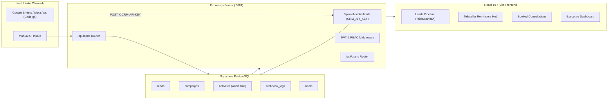

# Solar Bunker CRM — Master Technical Context & Project Record

> **Document Purpose:** Complete technical reference, architectural overview, database specification, and chronological record of all conversations and engineering milestones for the Solar Bunker CRM. Keep this file updated as a historical record.

---

## 1. Executive Summary

* **Project Name:** Solar Bunker CRM (developed for Solar Bunker / Enervia)
* **Application Nature:** Comprehensive, responsive solar sales CRM for lead intake, telecalling operations, consultation bookings, and technician site inspections.
* **Production Deployment:** [https://solar-bunker-crm.onrender.com](https://solar-bunker-crm.onrender.com)
* **Local Development:**
  * **Frontend (Vite UI):** `http://localhost:5173`
  * **Backend API (Express):** `http://localhost:3001`
* **GitHub Repository:** [https://github.com/dhruv4050/solar-bunker-crm.git](https://github.com/dhruv4050/solar-bunker-crm.git) (Branch: `main`)
* **Authoritative Database:** Supabase PostgreSQL (Cloud)

---

## 2. System Architecture & Tech Stack



### Core Technologies
* **Frontend:** React 19, Vite 8, Lucide React icons, Vanilla CSS design system (solar amber `#f59e0b`, teal `#0d9488`, slate `#0f172a`).
* **Backend:** Node.js, Express.js (ES Modules), CORS whitelist, dotenv.
* **Database & Auth:** Supabase PostgreSQL (`@supabase/supabase-js`), Supabase Auth, bcrypt password hashing.
* **Hosting & CI/CD:** Render Web Service with automatic git-push deployments connected to `main`.
* **Automation:** Google Apps Script (`Code.gs`) with recurring 5-minute time-based triggers.

---

## 3. Database Schema & Tables (Supabase PostgreSQL)

| Table | Description | Key Columns |
| :--- | :--- | :--- |
| `leads` | Core lead repository | `id`, `crm_lead_id`, `name`, `phone`, `email`, `city`, `monthly_bill`, `estimated_monthly_bill`, `budget`, `homeowner`, `property_type`, `roof_type`, `qualification`, `call_status`, `pickup_status`, `interest_level`, `call_timestamp`, `meeting_booked`, `meeting_date`, `meeting_time_slot`, `meeting_notes`, `assigned_technician_id`, `assigned_technician_name`, `campaign_id`, `campaign_name`, `source_sheet`, `raw_data` (JSONB) |
| `activities` | Immutable audit trail & history | `id`, `lead_id`, `activity_type`, `outcome`, `notes`, `performed_by`, `performed_at`, `next_follow_up_at` |
| `campaigns` | Ingestion sheets & Meta campaigns | `id`, `name`, `source_type`, `spreadsheet_id`, `sheet_name`, `created_at`, `updated_at` |
| `webhook_logs` | Webhook ingestion telemetry & deduplication | `id`, `payload`, `lead_id`, `source`, `status`, `received_at`, `ip_address` |
| `users` | CRM staff credentials & roles | `id`, `name`, `email`, `password_hash`, `role` (`admin`, `caller`, `technician`), `created_at` |

### JSON Metadata (`raw_data` Column)
To guarantee zero-downtime flexibility and avoid breaking SQL migrations, extended operational fields are stored in `raw_data` and automatically mapped in `formatLead()` in `server/db.js`:
* `nextFollowUpDate`: Scheduled date string (`YYYY-MM-DD`).
* `nextFollowUpTime`: Preferred time slot string (e.g., `Morning (10:00 AM - 12:00 PM)`).
* `nextFollowUpNotes`: Spacious multi-line notes written by the telecaller.
* `initialCallCompleted`: Boolean indicating whether the initial outreach was placed.
* `initialCallTimestamp`: ISO timestamp of the initial call.
* `followUpHistory`: Chronological array of completed call events and overdue resolutions.

---

## 4. Role-Based Access Control (RBAC)

The CRM enforces strict role-based view and endpoint restrictions:

| Role | Accessible Views | Permissions & Scope |
| :--- | :--- | :--- |
| **Administrator (`admin`)** | Overview Dashboard, Leads Pipeline, Booked Meetings, Reminders Hub, Webhook Hub, Settings | Full read/write access to all leads, campaigns, users, system settings, and webhook logs. |
| **Telecaller (`caller`)** | Leads Pipeline, Booked Meetings, Reminders Hub | Can view pipeline leads, execute Box 1 initial calls, schedule next follow-ups, and book customer consultation meetings. Restricted from settings and webhook hubs. |
| **Site Technician (`technician`)** | Booked Meetings (Consultations) ONLY | Strictly restricted to meetings assigned to them (`assigned_technician_id` or `assigned_technician_email`). Cannot view the general sales pipeline or telecalling queues. |

---

## 5. Chronological History of Conversations & Milestones

### Milestone 1: Initial Architecture & Webhook Ingestion
* Setup of Express backend and React Vite frontend.
* Implementation of secure webhook endpoint `POST /api/webhooks/leads` gated with `X-CRM-API-KEY`.
* Configured Render deployment file (`render.yaml`).

### Milestone 2: Cloud Database Migration to Supabase PostgreSQL
* Replaced local SQLite (`solar_bunker_crm.db`) with cloud authoritative Supabase PostgreSQL to eliminate ephemeral file-system wipes on Render free-tier restarts.
* Migrated historical leads, campaigns, and activity audit trails.
* Implemented automatic multi-candidate key resolution in `executeSupabase()` (`SUPABASE_SECRET_KEY`, `SUPABASE_SERVICE_ROLE_KEY`, `SUPABASE_KEY`).

### Milestone 3: Authentication, RBAC & First-Admin Bootstrap
* Developed production cryptographic session authentication.
* Added user management modal in Settings and CLI bootstrap utility (`scripts/bootstrap-admin.js`).
* Implemented password reset and secure admin-only password change feature.

### Milestone 4: Production Hardening & Brand Identity
* Resolved CORS origin checks on Render production subdomains (`https://*.onrender.com`).
* Added defensive normalization (`normalizeLead()`) to protect frontend components against null payloads.
* Branded login screen with the official circular Solar Bunker / Enervia logo, favicons, and solar glowing color palette.

### Milestone 5: Google Apps Script Production Tooling
* Created production-grade Google Apps Script (`google-apps-script/Code.gs`).
* Added intelligent column auto-mapping (name, phone, city, electricity bill, roof type, property type).
* Built-in duplicate prevention based on phone number and sheet row tracking.
* Set up 5-minute automated background sync triggers (`createFiveMinuteTrigger()`).

### Milestone 6: Telecaller Workflow Overhaul (Current Phase)
* **The Problem Identified:** The old 5-stage automated cadence (`followUpSequence` 1 to 5) flooded the telecaller with 70+ arbitrary pending tasks, causing severe cognitive overload and anxiety.
* **The Solution Implemented:**
  1. **Box 1 (Initial Call Placed):** Single toggle card that stamps the date/time and marks status as `Called`.
  2. **Next Follow-Up Scheduler:** Clean date picker (`<input type="date" />`) and time window selector allowing any date (e.g. 2 months later).
  3. **Expanded Multi-Line Notes:** Spacious `<textarea>` for detailed conversation notes.
  4. **Reorganized Reminders Hub:**
     * 🔔 **Today's Due:** Only leads scheduled for today.
     * 🚨 **Overdue (Red Alert):** Missed calls with days-missed alert (`⚠️ Missed X days ago`).
     * 📥 **Fresh Leads:** Incoming uncalled leads awaiting first contact.
     * 📅 **Upcoming:** Future scheduled calls (e.g., in 2 months).
  5. **Audit Trail for Missed Calls:** Overdue resolutions permanently record: *"Overdue follow-up resolved. Originally scheduled for [Date]"*.
  6. **Automated Integration Suite:** 10/10 regression tests in `scripts/test-telecaller-workflow.js`.

---

## 6. Supabase Free Tier Capacity & Quota Analysis

A common question is whether the CRM will hit Supabase's free tier limits as lead volume scales.

### Limit Breakdown
* **Database Disk Storage Limit:** **500 MB**
* **Average Storage Per Lead:** ~1.5 KB to 2.5 KB (including text, `raw_data` JSON, activity logs, and B-tree indexes).
* **Estimated Lead Capacity:**
  $$\text{Capacity} = \frac{500 \times 1024 \text{ KB}}{2.5 \text{ KB/lead}} \approx \mathbf{204,800 \text{ leads}}$$
  *(At 1.5 KB average per lead, capacity exceeds **330,000+ leads**).*

### Current Utilization vs Limit
* **Current Lead Count:** **77 leads**
* **Current Database Size:** ~**2 MB** (mostly internal PostgreSQL system catalogs and schemas).
* **Current Utilization Percentage:** **~0.4%** of the 500 MB allowance.
* **Verdict:** You are **extremely far away from the limit**. The free tier will easily accommodate years of solar lead generation.

### Secondary Quotas
* **Bandwidth (Egress):** 5 GB / month (CRM text API responses consume minimal bandwidth; allows over 1,000,000 queries/month).
* **Monthly Active Users (Auth):** 50,000 MAU (CRM only has 5–10 internal team members).
* **Inactivity Policy:** Supabase pauses free databases after 7 days without queries. Because Google Apps Script syncs periodically and telecallers access the CRM daily, the database will **never** pause.

---

## 7. Key Environment Variables (`.env`)

```env
PORT=3001
CRM_API_KEY=sb_live_685682910eb67eb82ea6e31c6adc093209c5cbd5e07c32b2
PUBLIC_URL=https://solar-bunker-crm.onrender.com
SUPABASE_URL=https://muqrumruisowcvllxaeo.supabase.co
SUPABASE_SERVICE_ROLE_KEY=eyJhbGciOiJIUzI1NiIsInR5cCI6IkpXVCJ9...
```

---

## 8. Verification & Maintenance Commands

```bash
# Run local backend
npm run server

# Run local frontend (Vite)
npm run dev

# Execute full automated test suite (10 integration scenarios)
node scripts/test-telecaller-workflow.js

# Build production bundle
npm run build

# Deploy to production (Render auto-builds on push)
git add .
git commit -m "feat: description"
git push origin main
```
